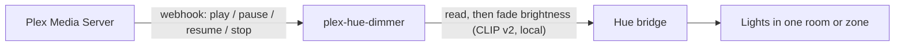

# Plex Hue Dimmer

Dims your Philips Hue lights while something plays on Plex, and gently puts
them back afterwards. It talks to the Hue bridge over your LAN, so no cloud
service is involved.

The lights should behave as if someone thoughtful were working the dimmer.
Nothing jumps, nothing flickers, and nothing undoes what you set by hand.

- **Stop means stop.** Stop something part-way through and the lights come
  straight back up.
- **Autoplay is seamless.** When an episode plays to the end, the lights wait
  (15s by default) before coming back up. If the next episode starts in that
  window, they never move. The service can tell these two kinds of stop apart
  because Plex sends a `scrobble` event once about 90% of an item has played.
- **Pausing gives you light without flicker.** A pause of a second or two
  changes nothing. After 5s the lights come part-way up, so someone can get up
  for a drink, but never brighter than they were before.
- **Your lights stay yours.** Only brightness is ever changed. Lights that are
  off stay off. Lights already at or below the dim level are left alone.
  Restoring returns each light to its own earlier brightness, not to 100%.
- **Hand changes win.** If you use the dimmer switch or the app while something
  plays, that light is left alone from then on: it isn't re-dimmed on resume or
  "restored" at the end. It joins in again when the next episode or movie starts.
- **It survives restarts.** State is saved, so a restart mid-movie still
  restores the right brightness afterwards.

## How it works



The lights follow the combined state of the players you choose:

| Players | Lights |
|---|---|
| Any playing | Fade to `DIM_LEVEL` over `DIM_TRANSITION` |
| All paused | After `PAUSE_DELAY`, fade to `PAUSE_LEVEL` (capped at each light's earlier level) |
| None left | After `STOP_DELAY` (stopped part-way) or `FINISHED_DELAY` (watched to the end), fade back to each light's earlier level |

Before every change the service reads each light. If it doesn't match what
the service last set, someone else changed it, and the service lets that light go.

Webhooks only reach the service for movies and episodes on the players you list,
so music, trailers and other rooms don't touch your lights.

## Requirements

- Plex Pass, which Plex needs for webhooks
- A Hue bridge (v2, the square one) on the same network
- Docker with Compose

## Setup

1. **Configure.**
   ```bash
   cp .env.example .env
   ```
   Set `HUE_BRIDGE` to your bridge's IP. https://discovery.meethue.com/ shows it.

2. **Pair with the bridge.** Press the round link button on the bridge, then within 30 seconds run:
   ```bash
   docker compose run --rm plex-hue-dimmer python plex_hue_dimmer.py pair
   ```
   Put the printed key in `HUE_APP_KEY`. If your bridge has more than one
   room or zone, set `HUE_GROUP` (the `groups` command lists them).

3. **Start it.**
   ```bash
   docker compose up -d --build
   ```

4. **Point Plex at it.** In Plex Web, go to Settings > Webhooks > Add Webhook and enter:
   ```
   http://127.0.0.1:8095/webhook
   ```
   Use the Docker host's LAN address instead if Plex runs on another machine, and set `BIND=0.0.0.0`.

5. **Choose your players.** While `PLEX_PLAYERS` is empty the service only
   logs. Play something on each player in the room and run:
   ```bash
   docker compose logs -f
   ```
   ```
   media.play on 'Living Room TV' (uuid 6f3c...) by 'alice': episode 'Pilot'
   ```
   Put the names or uuids in `PLEX_PLAYERS`, comma-separated, then run `docker compose up -d`.

## Tuning

Every setting lives in `.env` and is documented in
[.env.example](.env.example). The ones you're likely to touch:

| Setting | Default | |
|---|---|---|
| `DIM_LEVEL` | 15 | Brightness % while playing |
| `PAUSE_LEVEL` | 50 | Brightness % while paused |
| `PAUSE_DELAY` | 5 | Seconds paused before brightening |
| `STOP_DELAY` | 0 | Seconds after a part-way stop before restoring |
| `FINISHED_DELAY` | 15 | Seconds after something finishes before restoring. Must be longer than the gap before the next episode autoplays; that gap can reach about 12s after a 10s countdown |
| `*_TRANSITION` | 2–4 | Fade durations, in seconds |

`GET /state` on the webhook port shows what the service thinks is happening.

## Tests

```bash
docker build -t plex-hue-dimmer . && docker run --rm plex-hue-dimmer python -m unittest discover tests
```

## Security

- The webhook port binds to localhost by default. Set `WEBHOOK_TOKEN` if you
  expose it more widely.
- The container runs as a non-root user with a read-only filesystem and no capabilities.
- The bridge's HTTPS certificate is signed by Signify's private CA, so it isn't
  verified. Keep `HUE_BRIDGE` a LAN address.

## License

MIT
